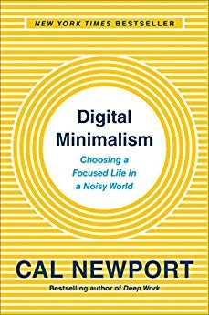
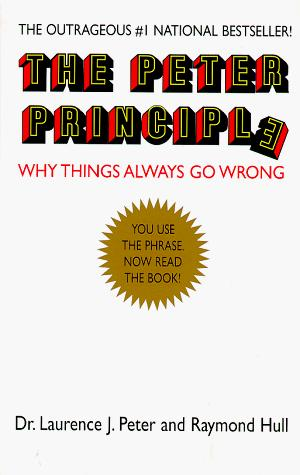
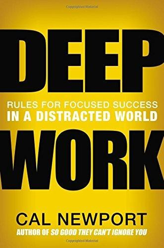
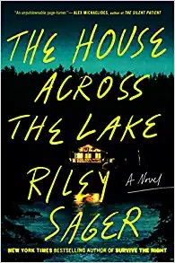
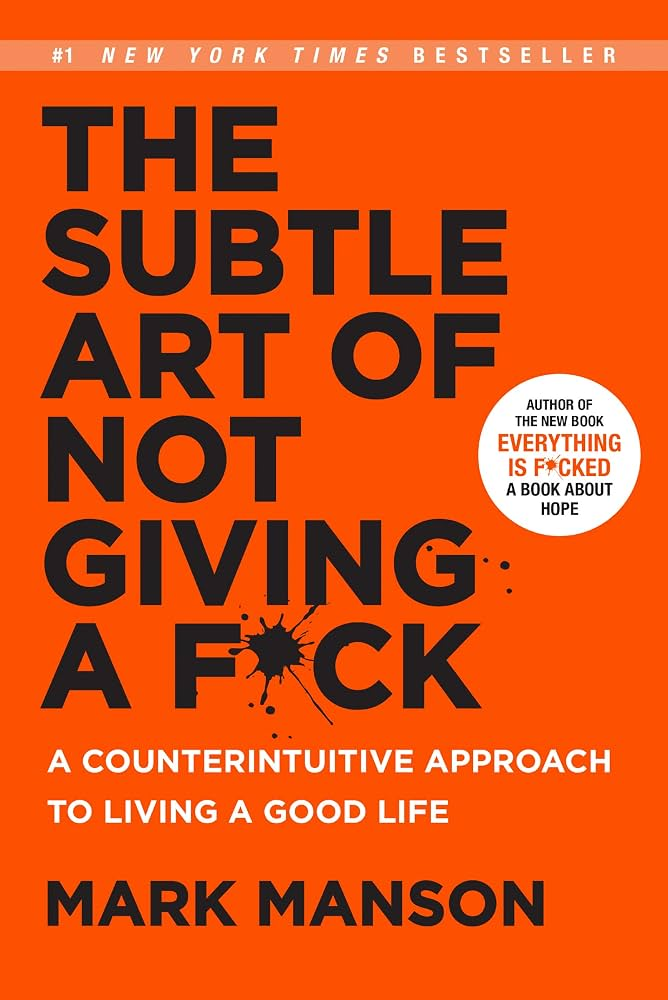

A running list of the books in my life — what's on the nightstand, what I've finished, and what's waiting.

## Currently reading

  
  <strong>Harry Potter and the Philosopher's Stone</strong> — J.K. Rowling

## Read

  
  <strong>Digital Minimalism</strong> — Cal Newport

  
  <strong>Make It Stick: The Science of Successful Learning</strong> — Peter C. Brown, Henry L. Roediger III &amp; Mark A. McDaniel

  
  <strong>The Peter Principle</strong> — Laurence J. Peter &amp; Raymond Hull

  
  <strong>Surrounded by Idiots</strong> — Thomas Erikson

  
  <strong>Deep Work</strong> — Cal Newport

  
  <strong>The House Across the Lake</strong> — Riley Sager

  
  <strong>The Subtle Art of Not Giving a F*ck</strong> — Mark Manson

  
  <strong>Hidden Pictures</strong> — Jason Rekulak

  
  <strong>The Devotion of Suspect X</strong> — Keigo Higashino

## Want to read

- *Title* — Author
