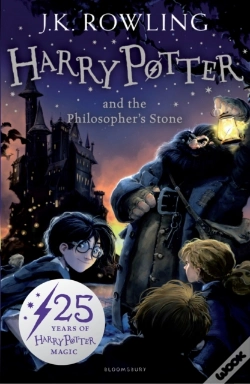
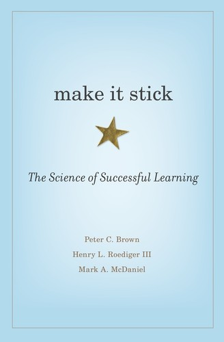
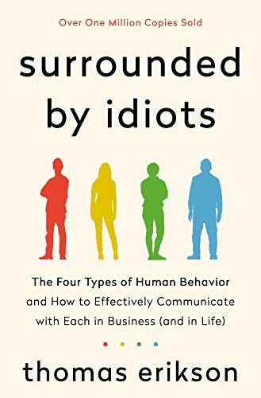
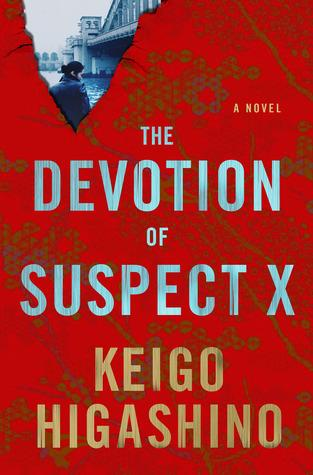

A running list of the books in my life — what's on the nightstand, what I've finished, and what's waiting.

## Currently reading

**Harry Potter and the Philosopher's Stone** — J.K. Rowling

## Read

**Digital Minimalism** — Cal Newport

**Make It Stick: The Science of Successful Learning** — Peter C. Brown, Henry L. Roediger III & Mark A. McDaniel

**The Peter Principle** — Laurence J. Peter & Raymond Hull

**Surrounded by Idiots** — Thomas Erikson

**Deep Work** — Cal Newport

**The House Across the Lake** — Riley Sager

**The Subtle Art of Not Giving a F*ck** — Mark Manson

**Hidden Pictures** — Jason Rekulak

**The Devotion of Suspect X** — Keigo Higashino

## Want to read

- *Title* — Author
