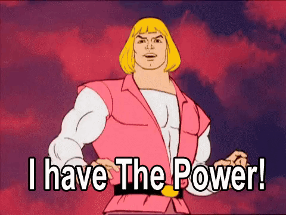
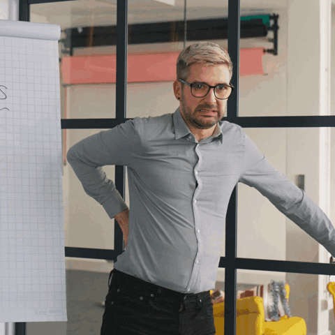
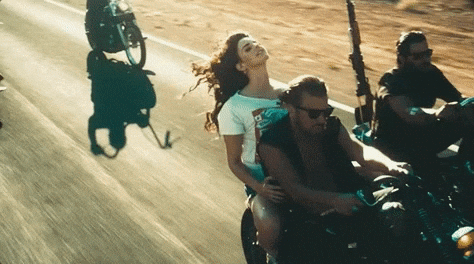
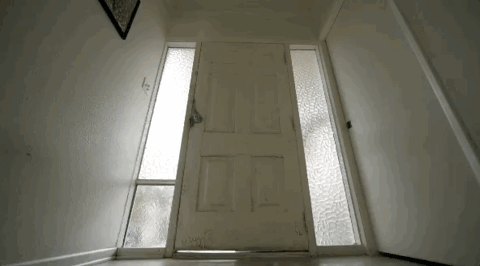

One of my favorite things to do is riding motorcycles. I've been doing it for 4 years now. I started riding a 125cc Benelli BN 125. It was a shit bike reliability-wise, but it gave me great joy riding it and many good moments. I learned to ride on it, doing figure eights with it.

It served me well to get the basics of motorcycle riding. Then, after some months, I decided to sign up for riding school, took the theoretical and practical classes, did the exam, passed it with some grunting from the examiner (typical), and done. I had unlocked the full potential to ride any motorcycle I wanted.

At this point, I was free to choose whatever bike I wanted, so I started looking at brands, models, reliability, and such, and I decided to get a Honda CB500X. You will notice that I have a preference for Japanese-made motorcycles. dThey have low maintenance costs and a reputation for being reliable.

With my CB500X, when I took it for the first spin out of the dealership, I felt a sensation of power. The bike was bigger, heavier, and more powerful than my little Benelli 125cc. That bike also gave me very good moments, and some not-so-good moments.

You see, I am not a tall person—I am 1.65m (5'5"). And as a first "real" bike, I decided to get a tall bike. Great... As you can imagine, I had to learn how to ride a tall bike: look at the pavement before stopping to see its inclination and decide which foot to put on the ground, shift my butt to one side or the other to gain more reach, and manage the bike's weight distribution. Yes, I could only put one foot on the ground completely, not both. With a 200kg bike, that was a lot to manage. After some time, you get used to it. Oh, I also put a 58L top case on it, so the rear caused the front to feel unstable, and turning the bike also felt like something was pulling it to the ground. Lesson learned about big top cases.

Either way, it was a good bike; I enjoyed it for the time I had it and did a lot of small trips on it. I had it for a year and some months. I sold it and got a bike better fitted for my stature.

I bought a Honda CB650R. This bike was a lot of fun. It was fun because I jumped from a 47-horsepower bike, which I thought was powerful, to a 95-horsepower bike. The bump was noticeable. The bike was shorter, so I could almost put both feet flat, and I could manage the weight better. It was smaller, so lane filtering felt much more comfortable. The best part was accelerating that bike; it reached top speed quickly. I also had very good moments and not-so-good moments with this one. It was powerful, small, and practical.

But riding it on the highway was a nightmare. With no wind protection like the CB500X had, at 100 km/h you had the full force of the wind hitting every part of your upper body. It's awful. You get used to it, but it still sucks. And the riding position killed me slowly. After a year of riding it daily, doing some short trips, and a trip to Picos de Europa, my lower back was screaming, "For the love of God, man, stop this madness." I'm not old, mind you—I'm in my early 30s. I weight train, run, and jump rope. So I'm not in bad shape per se, dismissing some belly fat here and there. Small details... you get the point.

My back hurting on this bike wasn't because of old age or being out of shape; naked bikes just have this effect. When you're on the short end of the height spectrum, you suffer more because you have to lean and stretch further to reach the handlebars. I kept it for some time then I sold it and in the meantime went back to tall adventure bikes.

I bought a Honda NX500 and I still ride it today. It is the next-generation model following the CB500X. Some design changes, tweaks, and gadgets were added, but overall, it's the same bike. Why did I buy a tall bike again? Well, because it was cheap and came with a discount at the time, the riding position is way more comfortable, you get wind protection that a naked bike like the CB650R lacks, and it consumes much less fuel. It has less power, but still enough to have fun.

What about the height and weight? To my surprise, I managed them much better than the first one. I managed it so well that I went back to Picos de Europa solo, did a trip to Gibraltar with some friends, and took various other trips around the country, alongside daily commuting to work. This continues to be the first bike I haven't dropped yet. Yes, I've dropped all my other bikes at least once while stopped. It happens; the bike didn't break or get scratched, and I didn't think too much about it. Besides that, I've been pretty happy with this bike.

Ok, background story done. Now to get to the main point of this wall of text. Since getting my full motorcycle license, I've experienced different bike types—both through the ones I bought and test rides just to satisfy my curiosity. I've reached the conclusion that I am neither a sportbike rider nor a naked motorcycle enthusiast. You've read my experiences; I also don't fancy riding at high speed. It's dangerous and not very fun, to be honest. The fun part is reaching top speed, but continuing at that pace is just recklessness and monotony.

Since I got the NX500, I've been enjoying riding slowly much, much more. Cruising at low speeds lets me appreciate the ride, the scenery, and everything happening around me. I can actually see things as they are, not as blurs from high speed. I take my time and genuinely relax. Of course, I'm talking about cruising on national roads. Highway motorcycle riding is just stressful and boring. You get hit by the noise of the wind, everyone is acting like they are on a race track, doing crazy lane switches. Its just too much stress.

You can call me an old man as much as you like, but slow riding in a constantly fast-paced world, where everything needs to be done, thought about, and spoken quickly because of FOMO, I guess, is a blessing and a much-needed moment of peace. I think this applies to other things as well. Doing things slowly is necessary. Maybe I can discuss that in detail in another post.

However, I'm not a tall adventure motorcyclist either. Sure, I can manage my NX500's height and weight now, but that is my limit for a tall bike. Anything taller and I'd need high heels to reach the ground. So this year, I tried and bought something I never thought I would—something I used to consider a lower form of motorcycling, a blasphemy, you might say. I tried and bought a scooter.

Now, before the "scooter police" bust into my house SWAT-style to address my previous degrading comments...

Let me explain. When I started my motorcycling journey, I hung out with other riders—some more experienced—who considered anything below 1000cc (or stretching to 500cc as an absolute minimum) to be God's unholy mistake on Earth. Those who rode anything below those displacements weren't even worth sharing the same air with, let alone receiving the traditional motorcycle wave that signals respect (_"You, my good sir/miss, have a nice bike. Take care"_).

Yes, this was my reality back then. I wasn't actively targeting scooter or small-cc riders on the road to beat them up like in _Road Rash_, but I joked about them, saying they were slow and just for old people going to buy groceries 50 meters from home. I took part in the mockery. I won't deny it. Then I tried one, and I was proven wrong.

I test-drove a Yamaha NMAX 125cc. The scooter was smaller, lighter, and less powerful than my NX500, for obvious reasons. But I could reach the ground with both feet! I could pull it back and forth easily with my feet. I had wind protection on my torso and legs—something I hadn't even considered until I tried it. And then, the final piece that cleansed my unholy spirit: the seat. It felt like sitting on a sofa. So comfy.

After riding it for a while and going back to my NX500, I can no longer stand the seat on the NX500, which I once swore was comfortable. I'm actually thinking about buying an aftermarket seat for it; 45 minutes to an hour is my limit on that wooden plank.

My views on motorcycling changed, quite drastically and in a short period of time. I like riding, but I also want comfort while doing it. I see many motorcyclists clinging to liter bikes or tall ADV bikes just to avoid admitting they want something that better fits their needs—something smaller, in most cases. Why suffer doing something you're supposed to enjoy?

And that's my take now. I can say I've rekindled my appreciation for small-cc motorcycles, much like I did with my old Benelli 125 BN. They are smaller and lighter, making them much more manageable in day-to-day life, and their maintenance costs and fuel consumption are low. They can't overtake other vehicles easily (mostly the 125cc ones, though 300cc might manage), but they weren't made for that anyway.

So, to conclude: I ride slowly, comfortably, and I have a great time doing it. Yes, it takes me longer to reach places sometimes, but I kind of need that. Taking more time.

Hope you enjoyed the read. See you in the next one. Take care!
